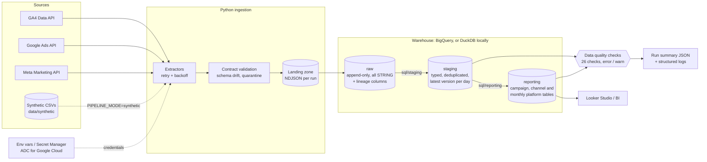

# marketing-data-integration-pipeline

End-to-end marketing data integration pipeline using Python, APIs, SQL and Google BigQuery.

It pulls **GA4**, **Google Ads** and **Meta Ads** data, lands it in a **raw** layer exactly as
delivered, cleans it into a **staging** layer, and builds **reporting** tables that answer the
question every paid-media team asks: *what did we spend, and what did the site get for it?*

The repository ships with realistic synthetic datasets and a local warehouse, so the whole
pipeline runs in about two seconds with **no cloud account and no API credentials**:

```bash
pip install -e ".[dev]"
python -m marketing_pipeline run
```

> **Status in one line:** everything runs and is tested locally on synthetic data, and the SQL
> models and quality checks have been run in BigQuery on a two-week slice with matching results.
> The Python BigQuery loader and the three live API extractors are written but have not been
> run against real services yet. See [What works and what still needs configuration](#what-works-and-what-still-needs-configuration).

## Architecture



The switch between synthetic and live data, and between DuckDB and BigQuery, is configuration
only (`PIPELINE_MODE`, `WAREHOUSE`). Extractors and warehouses sit behind small interfaces, so
the validation, SQL models and quality checks are the same code in every combination.

More detail: [docs/architecture.md](docs/architecture.md) · [docs/data_dictionary.md](docs/data_dictionary.md) · [docs/bigquery_validation.md](docs/bigquery_validation.md) · [docs/going_live.md](docs/going_live.md)

## Quick start

Requires Python 3.10 or newer.

```bash
git clone https://github.com/Guri-L/marketing-data-integration-pipeline.git
cd marketing-data-integration-pipeline
python -m venv .venv && source .venv/bin/activate
pip install -e ".[dev]"

python -m marketing_pipeline run      # extract -> load -> transform -> quality checks
pytest -q                             # 48 tests
```

Other commands:

| Command | What it does |
| --- | --- |
| `python -m marketing_pipeline run --start 2026-10-01 --end 2026-10-31` | Run for a specific window |
| `python -m marketing_pipeline run --skip-ingest` | Rebuild staging/reporting from existing raw data |
| `python -m marketing_pipeline generate-data` | Regenerate the synthetic datasets (deterministic) |
| `python -m marketing_pipeline show-sql` | Print every model as BigQuery DDL |
| `python -m marketing_pipeline check-config` | Validate settings without running anything |

After a run, explore the local warehouse:

```bash
python -c "import duckdb; duckdb.connect('artifacts/warehouse.duckdb').sql('select * from reporting.rpt_platform_summary_monthly order by 1, 2').show()"
```

## What the pipeline produces

`reporting.rpt_platform_summary_monthly` from the synthetic data (selected columns):

| month_start | platform | spend | platform_roas | ga4_roas | ga4_untracked_sessions | utm_coverage_rate |
| --- | --- | ---: | ---: | ---: | ---: | ---: |
| 2026-08-01 | google_ads | 33,100.38 | 4.38 | 2.64 | 0 | 1.0000 |
| 2026-08-01 | meta_ads | 17,885.27 | 2.36 | 1.41 | 1,505 | 0.9301 |
| 2026-09-01 | google_ads | 33,647.32 | 4.27 | 2.63 | 0 | 1.0000 |
| 2026-09-01 | meta_ads | 18,313.24 | 2.42 | 1.40 | 2,402 | 0.8946 |
| 2026-10-01 | google_ads | 36,612.50 | 4.72 | 2.99 | 0 | 1.0000 |
| 2026-10-01 | meta_ads | 28,574.06 | 2.55 | 1.70 | 3,540 | 0.9031 |

Two things this table is built to show, because they are the usual arguments in a marketing team:

- **Platform ROAS vs GA4 ROAS.** Ad platforms claim more revenue than GA4 attributes to them.
  Both numbers are kept side by side instead of picking one.
- **Tracking coverage.** Some Meta sessions arrive without a `utm_campaign`. They are counted as
  untracked rather than dropped, and a quality check warns when coverage falls below 90%
  (it fires for September in the synthetic data, on purpose).

### Layers

| Layer | Tables | Rules |
| --- | --- | --- |
| **raw** | `ga4_sessions`, `google_ads_campaign_performance`, `meta_ads_campaign_insights` | Append-only. Every source field stored as `STRING` exactly as delivered, plus `_run_id`, `_ingested_at`, `_source_system`. Nothing is cleaned here, so a load cannot fail or silently coerce a bad value. |
| **staging** | `stg_ga4__sessions`, `stg_google_ads__campaign_daily`, `stg_meta_ads__campaign_daily` | One model per source. Types cast with `SAFE_CAST`, units fixed (Google `cost_micros` to currency), names normalised, duplicates removed, and each date taken from the most recent batch so restated figures replace old ones. |
| **reporting** | `rpt_paid_media_campaign_daily`, `rpt_channel_performance_daily`, `rpt_platform_summary_monthly` | Cross-source tables at a documented grain with derived metrics (CTR, CPC, CPM, CPA, ROAS). |

SQL lives in [`sql/`](sql). Each file is a single `SELECT` in BigQuery Standard SQL; the file
name is the table name and build order is worked out from the `{{ layer.table }}` references.
For local runs the same files are transpiled to DuckDB with [sqlglot](https://github.com/tobymao/sqlglot).

### Synthetic data

[`data/synthetic/`](data/synthetic) holds three months (2026-08-01 to 2026-10-31) of data for a
fictional EU skincare shop: 11 campaigns across Google Ads and Meta, plus organic, direct, email
and referral traffic in GA4. It is generated by
[`synthetic/generator.py`](src/marketing_pipeline/synthetic/generator.py) with a fixed seed, and
a test fails if the committed files drift from the generator.

The files copy the real APIs' field names and formats (`cost_micros`, `YYYYMMDD` dates, decimal
strings) and include the mess real exports have: duplicate rows from overlapping extracts,
`Facebook` vs `facebook`, missing UTMs, and platforms claiming more conversions than GA4 sees.
Each of these is handled in staging and covered by a test.

## Data quality validation

Validation happens at two points.

**Before loading** ([`quality/validation.py`](src/marketing_pipeline/quality/validation.py)):
each extract is checked against its source contract. A changed column set (schema drift) or an
empty extract fails that source. Rows with an empty required field or an unparseable date are
written to `rejected.ndjson` with the reason; if more than 5% of rows are rejected, the source fails.

**After transforming** ([`config/data_quality.yaml`](config/data_quality.yaml)): 26 declarative
checks run as SQL against staging and reporting.

| Check type | Example |
| --- | --- |
| `not_null`, `unique` | Staging grain is unique: one row per date, account, campaign |
| `non_negative`, `expression` | Spend is never negative; `clicks <= impressions` |
| `accepted_values` | `platform` is `google_ads` or `meta_ads` |
| `freshness` | Newest date is within 2 days of the run window's end |
| `sql` (reconciliation) | Reporting spend equals staging spend to the cent; channel sessions equal staged GA4 sessions |

`error` checks fail the run with a non-zero exit code. `warn` checks are reported only. All
checks run even when one fails, so a single run shows every problem.

## Error handling and logging

- **Typed exceptions** ([`exceptions.py`](src/marketing_pipeline/exceptions.py)) separate
  configuration, extraction, validation, load, transform and data quality failures.
- **Retries** with exponential backoff and jitter apply only to transient errors (rate limits,
  timeouts, 5xx). Auth and bad-request errors fail immediately.
- **Source isolation.** If one source fails, the others still load to raw, but the run is
  marked failed and transforms are skipped, so reporting is never rebuilt from partial data.
- **Fail fast on configuration.** Missing settings are all listed at once before any network call.
- **Run summary.** Every run, including failed ones, writes `artifacts/runs/<run_id>.json` with
  per-source row counts, model row counts and timings, every check result, and errors.
- **Logs** carry the run id on every line. `LOG_FORMAT=json` switches to one JSON object per
  line for Cloud Logging.

## Secure credential management

- No credentials in the repository. `.env`, key files and `google-ads.yaml` are git-ignored;
  [`.env.example`](.env.example) lists every variable with empty values.
- Google Cloud access uses **Application Default Credentials**. The project never reads a
  service-account key file path.
- API secrets come from environment variables or **GCP Secret Manager** (`SECRET_BACKEND`).
- Secrets are wrapped in a `Secret` type that prints as `********`, and a logging filter masks
  secret values and token-shaped strings in log messages, tracebacks and the run summary.
- The Meta token is sent in the `Authorization` header and paging uses cursors, because Meta's
  `paging.next` URL embeds the token.

## What works and what still needs configuration

**Verified by running it** (locally and in the automated tests):

| Area | Evidence |
| --- | --- |
| Synthetic data generation | Deterministic; committed files match the generator |
| Full pipeline on DuckDB | 3 sources, 6,148 raw rows, 6 models, 25 of 26 checks pass and 1 intended warning |
| Deduplication, restatements, idempotent re-runs | Integration tests |
| Spend and sessions reconcile from source file to every reporting table | Integration tests |
| Failure paths: source outage, schema drift, bad values, unexpected errors | Integration tests |
| Retry policy, secret masking, config validation | Unit tests |
| Meta extractor paging, retry and token handling | Unit tests against a fake HTTP session |
| SQL models and quality checks execute in BigQuery | Run in a real project on a two-week slice, see [docs/bigquery_validation.md](docs/bigquery_validation.md) |
| BigQuery and DuckDB produce the same results | Row counts and totals of every table match; 3 of 84 derived ratios differ by 0.01 |
| Lint | `ruff check .` passes |

**Written but not yet run against real services:**

| Area | What is unverified | What it needs |
| --- | --- | --- |
| BigQuery loader (Python) | `BigQueryWarehouse` has never run: dataset creation and load jobs through the client library are untested. The BigQuery validation loaded data with SQL instead. The full three-month dataset has not been loaded. | `WAREHOUSE=bigquery`, `GCP_PROJECT_ID`, `BQ_LOCATION`, Application Default Credentials |
| GA4 extractor | Request building was checked against the installed client library; no report has been fetched. | `GA4_PROPERTY_ID`, Viewer access for the ADC identity |
| Google Ads extractor | Client construction was checked against the installed library; no query has been run. | Developer token, OAuth client and refresh token, customer id |
| Meta Ads extractor | Never called the real API. The purchase action type can differ per account. | System-user token with `ads_read`, account id, `META_API_VERSION` |
| Secret Manager backend | Never called. | Secrets created, `secretAccessor` role |

Step-by-step setup for each of these is in [docs/going_live.md](docs/going_live.md). The first
step is running the full synthetic dataset into BigQuery with the Python loader, which needs
Application Default Credentials but no API credentials.

**Known limitations**

- GA4 is joined to ad platforms on `utm_campaign = campaign name`. Renamed campaigns or
  duplicate names break the match; joining on a campaign id passed in the UTM is more robust.
- One currency is assumed. There is no currency conversion.
- Money is stored as `FLOAT64`. Totals reconcile to the cent, but a derived ratio that lands
  exactly on half a cent can round differently between engines. `NUMERIC` would remove this.
- Models are full refreshes. Fine at this volume; large accounts would need incremental models.
- There is no scheduler. The CLI is designed to be run by Cloud Run Jobs, Cloud Composer or cron.
- GA4 `total_users` is stored in staging but not in reporting, because users cannot be summed
  across dimensions.

## Project structure

```
├── config/data_quality.yaml        # declarative data quality checks
├── data/synthetic/                 # committed synthetic source exports
├── docs/                           # architecture, data dictionary, going-live guide
├── sql/
│   ├── staging/                    # one model per source
│   └── reporting/                  # cross-source reporting tables
├── src/marketing_pipeline/
│   ├── cli.py                      # command line entry point
│   ├── pipeline.py                 # orchestration and failure policy
│   ├── config.py                   # settings from environment
│   ├── secrets.py                  # Secret type, env / Secret Manager backends
│   ├── logging_utils.py            # run context, JSON logs, redaction
│   ├── retry.py                    # exponential backoff
│   ├── contracts.py                # raw-layer contract per source
│   ├── extract/                    # synthetic + GA4, Google Ads, Meta extractors
│   ├── load/                       # warehouse interface, DuckDB and BigQuery backends
│   ├── transform/runner.py         # dependency-ordered SQL model runner
│   ├── quality/                    # pre-load validation and post-transform checks
│   └── synthetic/generator.py      # synthetic data generator
├── tests/                          # 48 unit and integration tests
└── .github/workflows/ci.yml        # lint, tests and an end-to-end run on every PR
```

## Tech stack

Python 3.10+ · BigQuery Standard SQL · DuckDB (local warehouse) · sqlglot · pytest · ruff · GitHub Actions
