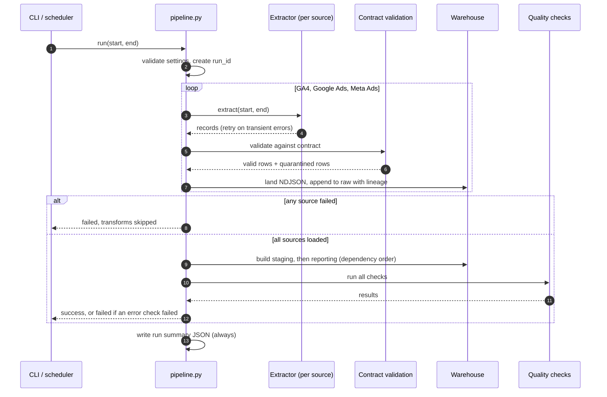

# Architecture

## Run sequence

## Design decisions

**Raw is append-only and untyped.** Each source field is stored as a string with `_run_id`,
`_ingested_at` and `_source_system`. A malformed value therefore cannot fail a load, and any
staging bug can be fixed and replayed with `run --skip-ingest` without calling the APIs again.

**Staging takes each date from its most recent batch.** Ad platforms restate recent days
(late conversions, invalid-click credits), so live runs re-fetch a trailing 7-day window. Staging
keeps, for every date, only the rows from the latest batch that contains it. This makes re-runs
idempotent, lets restated numbers replace old ones, and drops rows a source no longer returns.
A plain "latest row per key" dedup would keep those stale rows.

**One SQL dialect.** Models are written in BigQuery Standard SQL and transpiled to DuckDB for
local runs, rather than maintaining two copies or restricting SQL to a common subset. The
trade-off: a local pass proves the logic, not that BigQuery accepts every statement. The first
BigQuery run is the real check for that.

**Models are plain `SELECT` files.** The runner wraps each one in `CREATE OR REPLACE TABLE` and
orders them by their `{{ layer.table }}` references, with optional `-- partition_by:` and
`-- cluster_by:` headers for BigQuery. This gives dbt-like ergonomics without the dependency;
moving the models to dbt later is mostly renaming the references.

**Interfaces at the two edges.** `Extractor.extract(start, end)` and the `Warehouse` class are
the only places that know about a specific API or database. Tests inject fake extractors to
simulate outages, schema drift, bad values and restatements against a real (in-memory) warehouse.

**Partial data never reaches reporting.** A failed source does not stop the others from landing
in raw, but transforms are skipped for that run. Yesterday's complete reporting tables stay in
place rather than being replaced by tables missing a platform.

## BigQuery layout

| Dataset (default) | Contents | Partitioning |
| --- | --- | --- |
| `marketing_raw` | Raw source tables | `_ingested_at` (day) |
| `marketing_staging` | `stg_*` models | `date`, clustered by campaign or channel |
| `marketing_reporting` | `rpt_*` models | `date`, clustered by platform or channel |

Suggested access: the pipeline's service account gets `bigquery.dataEditor` on all three
datasets and `bigquery.jobUser` on the project; BI tools and analysts get `bigquery.dataViewer`
on `marketing_reporting` only.
